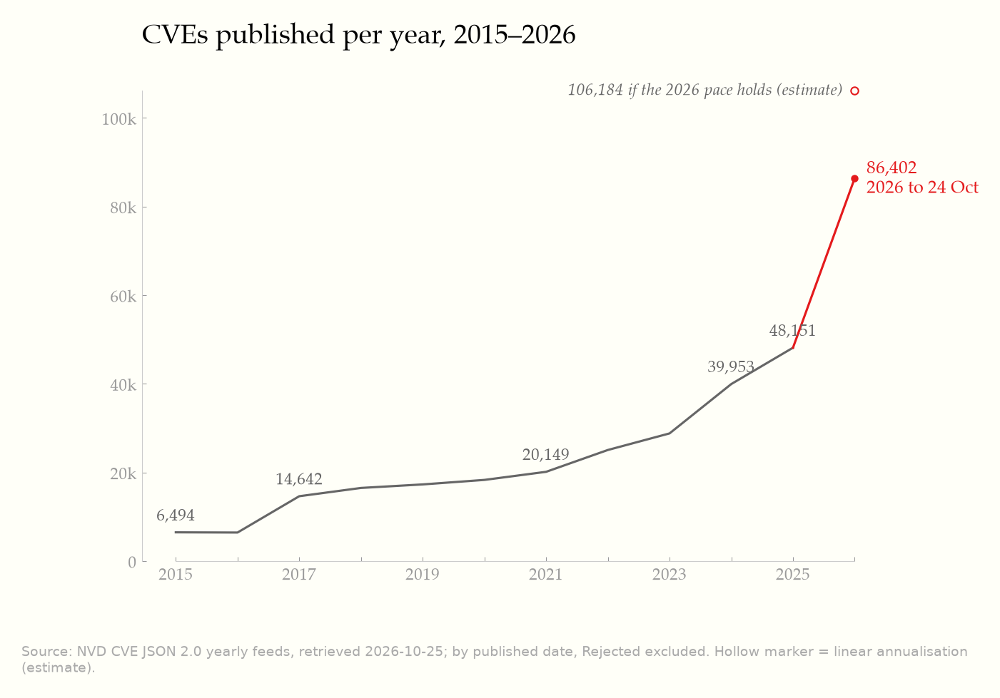
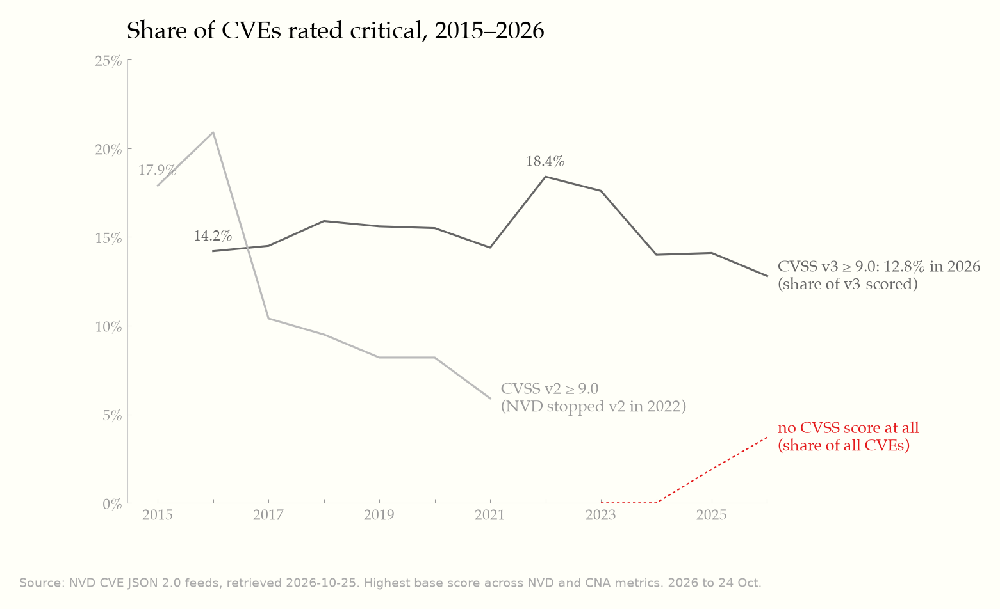
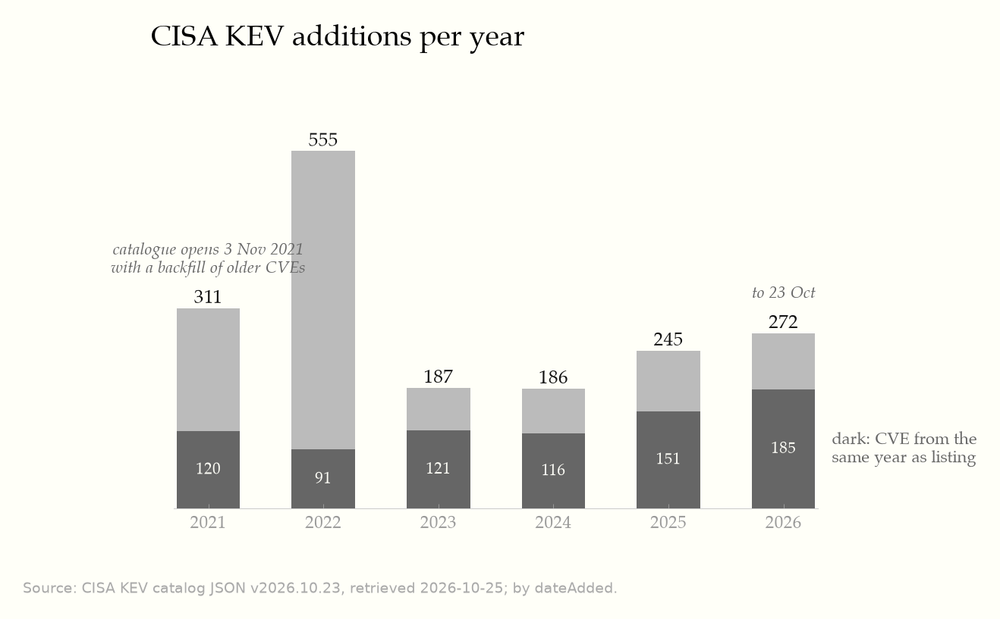
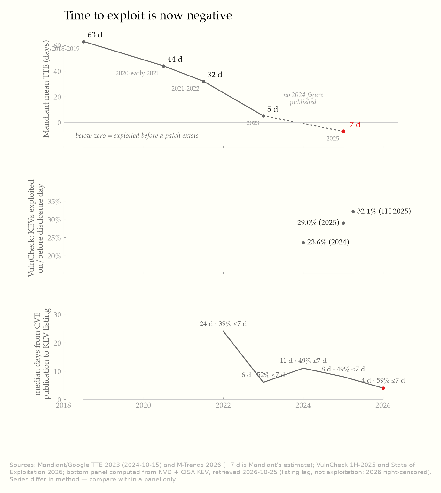
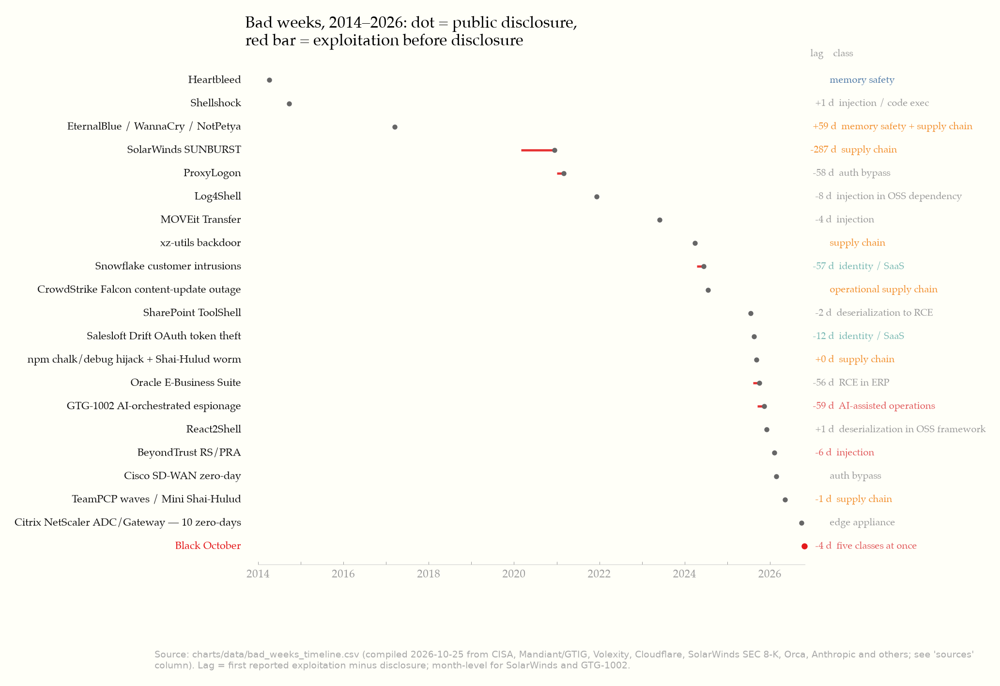
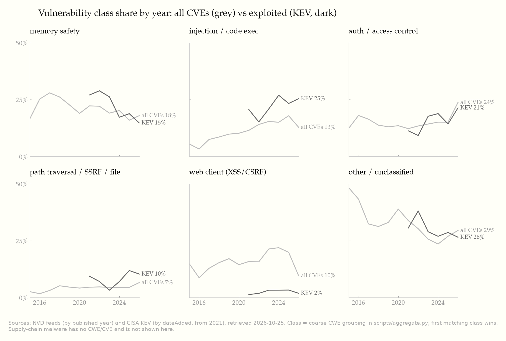
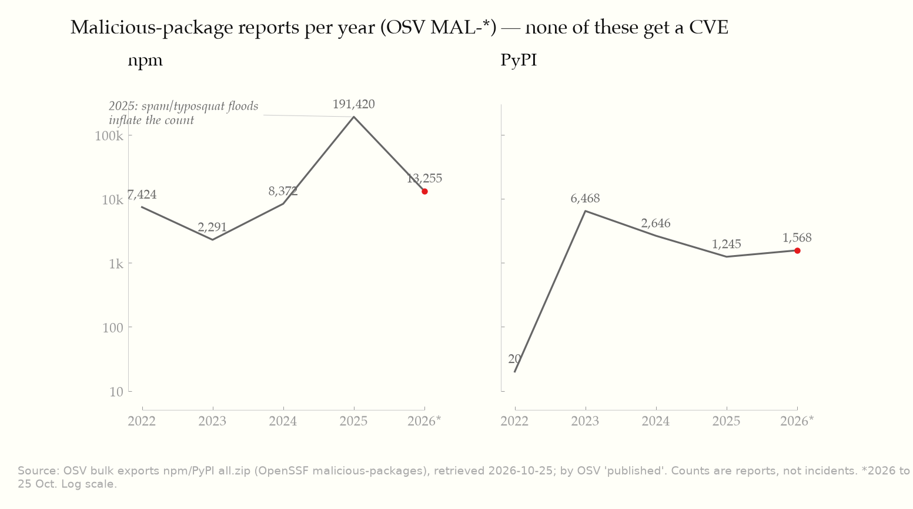

# Vulnerabilities over time: Black October in context

*Prepared 25 October 2026 for a Technology Leader audience (South Africa). Data retrieved 25 October 2026 unless stated. Numbers in square brackets refer to the source list at the end. "(estimate)" marks a vendor estimate or a value we derived. "Unverified" marks a claim we could not confirm at a primary source. Synthesis: an AI-generated first draft from the raw source files, then restructured and fact-checked. Corrections are listed at the end.*

## Bottom line

Black October (17–22 Oct 2026) was not a statistical outlier. It is the latest and densest example of a pattern we have seen at least nine times since 2014: a ubiquitous component fails and gets exploited **before** most defenders can act [R1–R9]. Four things are new in 2026:

1. **CVE volume has broken its trend.** There were 86,402 CVEs by 24 October, against 48,151 for all of 2025 [D1].
2. **Exploitation now regularly precedes the patch.** Mandiant's mean time to exploit is an estimated −7 days for 2025 [S2].
3. **AI now shows up on both sides.** It was used to discover PHP2Shell and BeyondTrust CVE-2026-1731, and to run intrusions (GTG-1002, ARTEX) [S1, S10, B].
4. **AI infrastructure is itself a target.** LiteLLM has three CISA KEV listings in 2026 as well as the October PyPI backdoor [D2, B].

Exploitation has grown much more slowly than disclosure. KEV added 272 entries this year to 23 October, against 245 in all of 2025 [D2]. GTIG counts about 18 exploited vulnerabilities a month in 2026, against 10.5 a month in 2025 [S1]. So the job is not "patch everything faster". It is to find the small exploited fraction within hours, investigate back to the first exploitation date rather than the disclosure date, and treat trust anchors (CAs, package registries, AI gateways, multi-tenant SaaS apps) as Tier-0 assets.

---

## 1. Volume over time

### 1.1 CVEs published per year

| Year | CVEs published | CVSS v3 ≥ 9.0 (share of v3-scored) | No CVSS at all |
|---|---:|---:|---:|
| 2015 | 6,494 | n/a (v2 ≥ 9.0: 17.9%) | 0% |
| 2017 | 14,642 | 14.5% | 0% |
| 2021 | 20,149 | 14.4% | 0% |
| 2023 | 28,816 | 17.6% | 0% |
| 2024 | 39,953 | 14.0% | 0.0% |
| 2025 | 48,151 | 14.1% | 1.9% |
| **2026 to 24 Oct** | **86,402** | **12.8%** | **3.7%** |

*Source: NVD CVE JSON 2.0 yearly feeds, retrieved 2026-10-25 [D1]. Counted by `published` date, with Rejected records excluded. These figures closely match Jerry Gamblin's independent 2025 review (39,962 for 2024 and 48,185 for 2025) [S6].*

- **The 2026 step change is real and recent.** Quarterly counts were 15,152 (Q1), 20,688 (Q2), 36,961 (Q3) and 13,601 (Q4 to 24 Oct) [D1]. GTIG independently reports monthly disclosures doubling from 5,045 in January 2026 to 10,477 in July and 10,740 in August [S1]. If the year-to-date pace holds, 2026 ends around 106,000 CVEs (estimate: linear annualisation).
- **Part of the growth is plugin ecosystems.** In 2025 Patchstack (7,007) and Wordfence assigned more CVEs than any traditional vendor, and CWE-79 (XSS) had over 8,000 entries [S6]. This matters in South Africa, where WordPress is widespread.
- **AI-assisted discovery is a likely driver of the 2026 jump** (our assessment). GTIG links the surge to AI-assisted discovery and shows AI-found bugs skew towards higher impact [S1]. Volume alone, however, overstates risk: only about 0.23% of 2026 disclosures (roughly 1 in 431) have been seen exploited [S1].

### 1.2 The share rated critical is flat, but "unscored" is growing

- Using CVSS v3, the critical share (base score ≥ 9.0) has stayed between **12.8% and 18.4%** every year since 2016 [D1]. So the number of critical CVEs scales with volume: about 10,000 so far in 2026, against 6,418 in 2025.
- **Method caveats.** NVD scored only CVSS v2 until 2016 (only 236 of 2015's CVEs carry a v3 score) and stopped issuing v2 in 2022, so 2015 uses v2 ≥ 9.0 and the two series cannot be joined. We take the highest base score across NVD and CNA metrics. That partly masks the NVD enrichment backlog: Gamblin reports full NVD enrichment for only 28% of 2025 CVEs [S6]. Even so, 3.7% of 2026 CVEs have **no score at all** [D1], so a CVSS-threshold filter silently drops them.

### 1.3 Known-exploited vulnerabilities (CISA KEV)

| Year added | KEV additions | of which the CVE is from the same year | Known ransomware use |
|---|---:|---:|---:|
| 2021 | 311 | 120 | 84 |
| 2022 | 555 | 91 | 132 |
| 2023 | 187 | 121 | 43 |
| 2024 | 186 | 116 | 44 |
| 2025 | 245 | 151 | 31 |
| 2026 to 23 Oct | 272 | 185 | 27 |

*Source: CISA KEV JSON catalogVersion 2026.10.23 [D2].*

- The catalogue opened on 3 November 2021 and spent 2021–22 backfilling older CVEs, so those two years are not comparable with later ones. From 2023 the steady state is **about 190–270 additions a year**, rising modestly. The number of **same-year** CVEs listed (121 → 185) is the better trend line: KEV is increasingly about new bugs.
- "Known ransomware use" is falling (44 → 27), but that field is set when evidence emerges and lags, so recent years will rise (assessment).
- **KEV is a lagging list.** As of catalogue 2026.10.23, **the PHP2Shell CVEs (CVE-2026-109618/-109619) are not in KEV**, even though AWS saw exploitation on 17 October [D2, B]. Don't wait for KEV during a bad week.

### 1.4 Time to exploit

| Measure | Values | Source |
|---|---|---|
| Mandiant mean TTE | 63 d (2018–19) → 44 d (2020–early 2021) → 32 d (2021–22) → 5 d (2023) → **−7 d (2025, estimate)** | [S3], [S2] |
| Mandiant zero-day share of exploited vulns | 62% (2021–22) → 70% (2023) | [S3] |
| GTIG zero-day share, Jan–Aug 2026 | 62% | [S1] |
| VulnCheck: KEVs exploited on or before disclosure day | 23.6% (2024) → 32.1% (1H 2025) → 28.96% (2025) | [S4], [S5] |
| GTIG exploited vulns per month | 10.5 (2025) → 18 (Jan–Aug 2026); zero-days 8 → 11 per month | [S1] |
| Median days from CVE publication to KEV listing (computed) | 24 (2022) → 6 (2023) → 11 (2024) → 8 (2025) → **4 (2026)**; share listed within 7 days: 39% → 59% | [D1, D2] |

- **These series are not methodologically consistent.** Mandiant's periods overlap and its samples differ by year. Mandiant published no 2024 TTE figure that we could find. The −7 days is Mandiant's own estimate. VulnCheck's base is its own, larger KEV list. Our listing-lag proxy measures how fast CISA lists a CVE, not how fast attackers exploit it, and 2026 is right-censored. Compare values within a row, not across rows.
- **What they agree on:** for the exploited minority, the window between disclosure and exploitation has collapsed from about two months (2018) to zero or below. M-Trends 2026 adds that the hand-off from initial access to a secondary threat group fell from over 8 hours in 2022 to **22 seconds** in 2025 [S2].
- **EPSS caveat.** Today's EPSS scores [D5] put about 6–13% of 2015–2019 CVEs at EPSS ≥ 0.1, against 0.23% of 2026 CVEs. That is an artefact of age (scores rise as exploitation evidence builds up), not evidence that new CVEs are safer. Use EPSS to rank today's backlog, not to compare years.

---

## 2. Comparable bad weeks and months

| Disclosure | Event | Class | Disclosure → first exploitation | Blast radius |
|---|---|---|---|---|
| 2014-04-07 | Heartbleed (OpenSSL) | memory safety | days (not precisely established) | ~17% / ~0.5M trusted TLS sites (Netcraft 2014, widely cited; unverified at source) |
| 2014-09-24 | Shellshock (Bash) | injection | +1 d | CGI-reachable hosts; botnet DDoS within 2 days [R2] |
| 2017-03-14 | EternalBlue → WannaCry → NotPetya | memory safety + supply chain | +59 d from patch (+28 d from the Shadow Brokers leak) | ~200,000 victims in 150+ countries (Europol); NotPetya "billions of dollars" (White House) [R3] |
| 2020-12-13 | SolarWinds SUNBURST | supply chain (build) | about −287 d (month-level) | fewer than 18,000 customers installed the affected Orion versions [R4] |
| 2021-03-02 | ProxyLogon (Exchange) | auth bypass → RCE | −58 d | tens of thousands of servers (estimate) [R5] |
| 2021-12-09 | Log4Shell | injection in an OSS dependency | −8 d | ubiquitous Java; CISA ED 22-02 [R6] |
| 2023-05-31 | MOVEit Transfer / Cl0p | SQL injection, file transfer | −4 d | 2,773 orgs / ~95.8M people (Emsisoft tally, estimate) [R7] |
| 2024-03-29 | xz-utils backdoor | supply chain (maintainer takeover) | n/a (caught early) | near miss on sshd in major distributions |
| 2024-06-10 | Snowflake customers (UNC5537) | identity / SaaS | −57 d | ~165 orgs potentially exposed [R8] |
| 2024-07-19 | CrowdStrike content update | operational supply chain (no attacker) | n/a | 8.5M Windows devices [R9] |
| 2025-07-19 | SharePoint ToolShell | deserialisation → RCE | −2 d | 85+ servers / 29 orgs in the first count [R10] |
| 2025-08-20 | Salesloft Drift OAuth theft | identity / SaaS | −12 d | 700+ orgs potentially affected (GTIG via THN) [R11] |
| 2025-09-08 | npm chalk/debug hijack + Shai-Hulud worm | supply chain (npm) | 0 d | 18 packages with >2B weekly downloads; 500+ packages [R12, R13] |
| 2025-10-04 | Oracle E-Business Suite / Cl0p | RCE in ERP (zero-day) | about −56 d | "dozens of organisations" [R14] |
| 2025-11-13 | GTG-1002 (Anthropic report) | AI-orchestrated operations | about −59 d to detection | ~30 targets; AI ran 80–90% of tactical work [S10] |
| 2025-12-03 | React2Shell (React Server Components) | deserialisation in an OSS framework | about +1 d | React 19 / Next.js server deployments; KEV on 5 Dec [R15] |
| 2026-02-06 | BeyondTrust CVE-2026-1731 (AI-discovered) | injection | −6 d or +4 d (**sources conflict**) | ~11,000 exposed instances; ransomware use [S1, R16] |
| 2026-02-25 | Cisco SD-WAN zero-day (ED 26-03) | auth bypass, edge | exploited before disclosure | global; Five Eyes guidance [R17] |
| 2026-05-12 | TeamPCP / Mini Shai-Hulud | supply chain (npm/PyPI, CI) | about −1 d | 169 npm + 2 PyPI packages, 373 versions, **with valid provenance** [S9] |
| 2026-09-27 | Citrix NetScaler, 10 zero-days | edge appliance | exploited before disclosure | global [R18] |
| **2026-10-21** | **Black October** | memory safety + PKI + supply chain + AI + identity | **−4 d** (PHP2Shell) | PHP web estate; a browser-trusted CA; AI-gateway credentials; 2,250+ M365 tenants targeted [B] |

The six most instructive:

- **Heartbleed (2014): the closest analogue to PHP2Shell.** A memory-safety bug in a near-universal runtime library meant every exposed service had the problem, whatever the application on top. Both show that the inventory question ("where do we run OpenSSL / PHP, including in appliances?") takes longer to answer than patching does.
- **EternalBlue/NotPetya (2017): the last time the lag was positive.** Defenders had 59 days after the patch and still lost. NotPetya then spread through a poisoned software update (M.E.Doc), a precedent for the LiteLLM pattern of "the vendor's own channel delivers the payload".
- **SolarWinds (2020): the far end of pre-disclosure exploitation.** Trojanised updates ran for about nine months before anyone knew. It is the reason compromise assessments should run from first exploitation, not from disclosure.
- **Log4Shell (2021): a dependency nobody knew they had.** Exploitation began 8 days before the public tweet [R6]. This is the SBOM lesson that LiteLLM repeats for AI stacks.
- **MOVEit (2023): mass data theft from one appliance class.** An extortion group used a zero-day against a single product category. The 2,773 organisations (estimate) were mostly downstream of vendors and service providers, which mirrors the risk from hosting providers and MSPs in Black October.
- **Mini Shai-Hulud (2026): supply-chain security controls can be turned against you.** Malicious packages shipped with valid npm provenance attestations [S9]. Signatures prove where a package was built, not that the build was safe.

**Pattern:** of the 16 entries with a measurable lag, **12 were exploited before disclosure** (11 if the disputed BeyondTrust case is excluded) [D3]. Clusters recur roughly every 6–18 months, and since 2025 they have arrived every two to three months.

---

## 3. Class trends

*Class = a coarse grouping of CWE IDs ([D1, D2]; mapping in `scripts/aggregate.py`). Because the first matching class wins, these are indicative.*

**Memory safety.** It makes up about 15–28% of all CVEs every year. Its share of exploited (KEV) entries fell from 29% (2022) to 15% (2026) [D1, D2]. It is not going away. PHP2Shell is a memory-safety bug in a C runtime, and GTIG reports AI tools exploring "semantic code paths across core C/C++ libraries, runtimes, and hypervisors" [S1]. *Black October fit: PHP2Shell.*

**Injection / code execution.** It is the largest exploited class: 25% of 2026 KEV additions against 13% of all CVEs [D1, D2]. Command injection in edge and management products dominates (BeyondTrust, Citrix, Cisco). GTIG puts edge and security appliances at 14% of exploited vulnerabilities in Jan–Aug 2026, with over 65% of exploited edge flaws rated High or Critical [S1].

**Auth / access control.** Its KEV share doubled, from 11% (2021) to 21% (2026), and it jumped in raw 2026 CVE counts (20,499 against 7,240 in 2025) [D1, D2]. Part of that jump may come from changes in how CNAs assign CWEs (assessment; not verified).

**Supply chain (npm/PyPI).** This is the class CVE statistics cannot see. Malicious packages get an OSV `MAL-` record, not a CVE.

OSV holds 191,420 npm malicious-package reports published in 2025 and 13,255 so far in 2026; PyPI has 1,245 and 1,568 [D4]. The 2025 npm figure is inflated by the IndonesianFoods token-farming spam campaign, which published over 100,000 packages (Sonatype via BleepingComputer) [S11]. Treat the series as reports, not incidents. The qualitative trend is clearer:
- 2017: NotPetya via a vendor update.
- 2020: SolarWinds' build system.
- 2024: xz-utils maintainer takeover.
- 2025: Shai-Hulud self-propagating worm (500+ packages) [R13].
- 2026: TeamPCP waves through CI/OIDC with valid provenance [S9], then LiteLLM 1.107.0 via PyPI **and** the official Docker images [B].

The target has moved from software vendors to maintainers' and CI credentials. *Black October fit: LiteLLM.*

**PKI / CA trust.** eMudhra is the outlier mechanism. Eight intermediate CA keys were trivially small, so the keys could be recovered from the public certificates in under a second [B]. Mozilla shipped OneCRL in under 3 hours, and eMudhra left the public TLS business 5 days later [B]. Historic CA distrust events (for example DigiNotar 2011 and the Symantec distrust 2017–18) are **not covered by this research pack and were not fact-checked here**. The common lesson is that **embedded and static trust stores** (appliances, containers, language runtimes) lag browsers by months. *Black October fit: eMudhra.*

**AI-assisted discovery and exploitation.**
- *Discovery:* GTIG finds that 50% of AI-discovered vulnerabilities lead to RCE, against 26% across all CVEs. AI-found bugs also skew to Medium risk (58% against 28%) rather than Low (39% against 69%) [S1]. Examples: PHP2Shell (Wiz, using several models) and BeyondTrust CVE-2026-1731 (found autonomously by Hacktron AI) [B, S1].
- *Operations:* Anthropic's GTG-1002 report (Nov 2025) describes a state-sponsored operator running about 30 targets, with AI doing 80–90% of tactical work. It also notes AI hallucination as a limiting factor [S10]. Microsoft's Storm-0940 used the open-source ARTEX multi-agent framework against more than 2,250 tenants, sometimes reaching privileged access in under 3 hours [B].
- *AI as a target:* GTIG counts 2,076 AI-stack CVEs from January 2025 to August 2026, with agent orchestration and framework flaws up 347% in 2026 [S1]. LiteLLM has three KEV entries in 2026: CVE-2026-42208, -42271 and -59822 [D2].
- GTIG also suggests attackers mainly use AI to turn patches and PoCs into working n-day exploits faster, rather than to find zero-days [S1].
- *Black October fit:* PHP2Shell (discovery), Storm-0940 (operations), LiteLLM (AI infrastructure as target).

**Identity / SaaS.** Snowflake (2024: infostealer credentials, no MFA), Salesloft Drift (2025: OAuth tokens from one integration, 700+ orgs) and Storm-0940 (2026: a compromised MSP backup app) form one line. The attacker exploits a trusted integration, not a CVE [R8, R11, B]. M-Trends 2026 has voice phishing as the #2 initial infection vector (11%), behind exploits (32%) [S2]. *Black October fit: Storm-0940, Railway (secrets in platform environment variables).*

---

## 4. What is new in 2026, and what is cyclical

| Cyclical (seen before; evidence) | New in 2026 (evidence) |
|---|---|
| **Pre-disclosure exploitation** of ubiquitous software: SolarWinds −287 d, ProxyLogon −58 d, Log4Shell −8 d, MOVEit −4 d, PHP2Shell −4 d [D3]. | **Negative mean TTE as the norm**, not the exception: Mandiant −7 d (estimate) [S2]. The median CVE→KEV listing lag is 4 days, with 59% of listings within a week [D1, D2]. |
| **Clusters of unrelated incidents** that the media labels as one event: 2014 (Heartbleed + Shellshock), 2017, 2021 (ProxyLogon then Log4Shell), mid-2025 [D3]. | **Five classes in one week.** Memory safety, PKI, supply chain, AI-driven operations and identity/secrets all struck within 17–22 Oct [B]. Earlier clusters spanned one or two classes. |
| **Edge appliances and file-transfer or ERP zero-days** used for mass data theft (MOVEit 2023, Oracle EBS 2025, Citrix 2026) [R7, R14, R18]. | **CVE volume has broken trend:** 86,402 to 24 Oct (about +79% on 2025 with two months to go), and a 36,961-CVE Q3 [D1]. GTIG ties part of the growth to AI-assisted discovery [S1]. |
| **Supply-chain compromise via update channels** (NotPetya 2017, SolarWinds 2020, xz 2024) [D3]. | **Supply-chain controls defeated, and AI infrastructure targeted:** malicious releases with valid provenance (TeamPCP) [S9]; LiteLLM backdoored and KEV-listed three times in 2026 [B, D2]. |
| **Credential and SaaS-integration abuse** (Snowflake 2024, Salesloft 2025) [R8, R11]. | **AI-orchestrated intrusion at scale:** GTG-1002 (detected Sep 2025) and ARTEX against 2,250+ tenants (Oct 2026) [S10, B]. |
| **CA trust failures** have happened before (background only; not verified here). | **CA key failure by trivial key values,** found and distrusted within hours. The mechanism is new; the outcome (distrust, then exit) is familiar [B]. |
| **The exploited fraction stays small.** KEV adds about 190–270 a year [D2]; GTIG puts 2026 exploitation at about 0.23% of disclosures [S1]. | **A faster exploited stream within a flood:** 18 exploited vulnerabilities a month against 10.5, and High-Risk exploitation more than doubled (28 in 2025 → 75 in Jan–Aug 2026) [S1]. |

**Our judgement:** the cadence of bad weeks is cyclical, but in 2026 three things changed: the speed of exploitation, the scale of disclosure, and AI on both sides. "Black October" will probably not be the last such label this year: in 2026 so far, a cluster has arrived every 2–3 months (February, May, September, October) [D3].

---

## 5. Implications for a CISO (South African context)

**Patch cadence assumptions**
- Stop measuring vulnerability management in monthly cycles for internet-facing runtimes and edge devices. Set the SLA in **hours** for any asset that matches a KEV or high-EPSS entry, or that a CERT or vendor reports as "exploited".
- Do not rely on KEV alone. PHP2Shell was still absent from KEV two days after the fix, despite exploitation [D2].
- Pair every emergency patch with a **compromise assessment that runs from the first-exploitation date** (17 October for PHP2Shell), not the patch date. Twelve of sixteen measurable bad weeks (11 excluding the disputed BeyondTrust case) involved exploitation before disclosure [D3].
- Do not filter only on CVSS ≥ 9. Of 2026 CVEs, 3.7% are unscored and the NVD backlog persists [D1, S6]. Use CNA scores, EPSS and exposure as fallbacks.

**SBOM, dependency pinning, cooldown**
- Keep a queryable SBOM for production and CI, covering container base images and AI/ML stacks (LiteLLM-class gateways).
- Pin dependencies by hash or digest, and **add a cooldown** before adopting newly published versions. The LiteLLM malicious window lasted about 2 hours on PyPI [B], and Mini Shai-Hulud showed that provenance alone is not enough [S9].
- Treat CI tokens and OIDC trust as production credentials (TeamPCP, LiteLLM) [S9, B].
- Watch OSV `MAL-` records against your lockfiles; CVE feeds will never show them [D4].

**CA trust management**
- Inventory every trust store: OS, Java, Python `certifi`, Node, containers, appliances, mTLS configurations. Make CA distrust a change you can push in hours.
- South African telco, banking and POS estates often ship static CA bundles (assessment, carried over from the 24 Oct briefing).

**AI-agent threat models**
- Treat AI gateways and agent platforms as **credential concentrators**: they hold API keys to every model provider, plus cloud credentials [B]. Apply Tier-0 controls (isolation, short-lived and scoped keys, spend caps, egress control).
- Assume adversaries run multi-agent tooling at machine speed (GTG-1002, ARTEX). Detection has to be behaviour-based and CVE-agnostic.
- Use AI-assisted code review on your own code before attackers do. GTIG recommends this explicitly [S1].
- Review MSP and multi-tenant app consents in Entra. Storm-0940 came in through a backup vendor's app [B].

**POPIA and the local picture**
- **s19 (security safeguards):** with TTE below zero and published emergency guidance (NSA, ENISA, CISA) [B], leaving a known-exploited runtime unpatched or a distrusted CA in a trust store would be hard to defend as "reasonable".
- **s22 (notification):** the look-back window for "reasonable grounds to believe" access occurred should run from first exploitation, which is 17 October for PHP2Shell [B].
- **Advisory gap:** the 24 October review found no South African CSIRT or Information Regulator advisory on Black October, while Namibia's NAM-CSIRT did publish one [B]. This was not re-checked on 25 Oct. Do not wait for local guidance.
- PHP and WordPress are heavily used across SA SME hosting and municipal and provincial sites (assessment; no local measurement in this pack). Combined with 2025's plugin-driven CVE volume [S6], that makes the "WordPress effect" a local priority.

**Metrics to track (quarterly, board-level)**
1. Median hours from a KEV or CERT "exploited" notice to patch or isolate, for internet-facing assets.
2. Share of emergency patches followed by a compromise assessment that looks back to first exploitation.
3. Share of production dependencies hash-pinned, and the cooldown compliance rate.
4. Number of long-lived secrets in platform environment variables and AI gateways (trend to zero, replaced by workload identity).
5. Trust-store drift: time to distrust a CA across all bundles.
6. Number of consented multi-tenant / MSP apps holding privileged scopes.

---

## Sources

**Data (computed from bulk files; scripts in `scripts/aggregate.py`, CSVs in `charts/data/`)**
- [D1] NVD CVE JSON 2.0 yearly feeds 2002–2026, https://nvd.nist.gov/feeds/json/cve/2.0/, retrieved 2026-10-25 (2026 feed last modified 2026-10-25 07:15 UTC).
- [D2] CISA KEV JSON, catalogVersion 2026.10.23, https://www.cisa.gov/sites/default/files/feeds/known_exploited_vulnerabilities.json, retrieved 2026-10-25.
- [D3] `charts/data/bad_weeks_timeline.csv`, compiled 2026-10-25 from the R-sources below.
- [D4] OSV bulk exports (OpenSSF malicious-packages, MAL-*), https://osv-vulnerabilities.storage.googleapis.com/{npm,PyPI}/all.zip, retrieved 2026-10-25.
- [D5] FIRST EPSS scores, model v2026.06.15, score date 2026-10-24, https://epss.empiricalsecurity.com/, retrieved 2026-10-25.

**Studies and reports**
- [S1] GTIG, "Vulnerability Discovery and Exploitation Trends in the AI Era", 2026-09-30. https://cloud.google.com/blog/topics/threat-intelligence/vulnerability-discovery-and-exploitation-trends-in-the-ai-era
- [S2] Mandiant, "M-Trends 2026", 2026-03-23. https://cloud.google.com/blog/topics/threat-intelligence/m-trends-2026
- [S3] Mandiant, "How Low Can You Go? An Analysis of 2023 Time-to-Exploit Trends", 2024-10-15. https://cloud.google.com/blog/topics/threat-intelligence/time-to-exploit-trends-2023
- [S4] VulnCheck, State of Exploitation 2026 (via Infosecurity Magazine, 2026-01-22). https://www.infosecurity-magazine.com/news/zeroday-exploits-surge-vulncheck
- [S5] VulnCheck, State of Exploitation 1H 2025. https://www.vulncheck.com/blog/state-of-exploitation-1h-2025
- [S6] Jerry Gamblin, "2025 CVE Data Review", 2026-01-01. https://jerrygamblin.com/2026/01/01/2025-cve-data-review/
- [S9] Orca Security, "TanStack and 160+ npm/PyPI packages compromised" (Mini Shai-Hulud). https://orca.security/resources/blog/tanstack-npm-supply-chain-worm/
- [S10] Anthropic, "Disrupting the first reported AI-orchestrated cyber espionage campaign", Nov 2025. https://assets.anthropic.com/m/ec212e6566a0d47/original/Disrupting-the-first-reported-AI-orchestrated-cyber-espionage-campaign.pdf
- [S11] BleepingComputer, "New IndonesianFoods worm floods npm with 100,000 packages". https://bleepingcomputer.com/news/security/new-indonesianfoods-worm-floods-npm-with-100-000-packages
- [B] Black October briefing, 2026-10-24 (the author's own fact-checked research note, 23 primary and secondary sources; unpublished). Its primary sources are cited directly wherever a figure here depends on them.

**Incident references**
- [R1] Heartbleed: https://heartbleed.com/ ; https://nvd.nist.gov/vuln/detail/CVE-2014-0160
- [R2] Shellshock: https://nvd.nist.gov/vuln/detail/CVE-2014-6271 ; https://thehackernews.com/2014/09/Shellshock-Bash-Vulnerability-exploit.html
- [R3] MS17-010: https://learn.microsoft.com/en-us/security-updates/securitybulletins/2017/ms17-010 ; Europol figure via https://www.executivegov.com/articles/europol-ransomware-attack-compromised-200k-computers-in-over-150-countries ; White House statement via https://www.darkreading.com/threat-intelligence/white-house-russian-military-behind-notpetya-attacks/d/d-id/1331078
- [R4] SolarWinds Form 8-K, 2020-12-14. https://www.sec.gov/Archives/edgar/data/1739942/000162828020017451/swi-20201214.htm
- [R5] Volexity, ProxyLogon, 2021-03-02 (updated 2021-03-08). https://www.volexity.com/blog/2021/03/02/active-exploitation-of-microsoft-exchange-zero-day-vulnerabilities/
- [R6] Cloudflare, Log4Shell exploitation before public disclosure. https://blog.cloudflare.com/exploitation-of-cve-2021-44228-before-public-disclosure-and-evolution-of-waf-evasion-patterns/
- [R7] CISA AA23-158A, 2023-06-07. https://www.cisa.gov/news-events/cybersecurity-advisories/aa23-158a ; Emsisoft. https://emsisoft.com/en/blog/44123/unpacking-the-moveit-breach-statistics-and-analysis/
- [R8] Mandiant UNC5537 via The Hacker News. https://thehackernews.com/2024/06/snowflake-breach-exposes-165-customers.html
- [R9] Microsoft, 2024-07-20. https://blogs.microsoft.com/blog/2024/07/20/helping-our-customers-through-the-crowdstrike-outage/
- [R10] SentinelOne, ToolShell. https://www.sentinelone.com/blog/sharepoint-toolshell-zero-day-exploited-in-the-wild-targets-enterprise-servers/
- [R11] GTIG, Salesloft Drift. https://cloud.google.com/blog/topics/threat-intelligence/data-theft-salesforce-instances-via-salesloft-drift ; The Hacker News. https://thehackernews.com/2025/08/salesloft-oauth-breach-via-drift-ai.html
- [R12] Semgrep, chalk/debug. https://semgrep.dev/blog/2025/chalk-debug-and-color-on-npm-compromised-in-new-supply-chain-attack
- [R13] CISA, Shai-Hulud npm alert, 2025-09-23. https://www.cisa.gov/news-events/alerts/2025/09/23/widespread-supply-chain-compromise-impacting-npm-ecosystem
- [R14] Oracle EBS / Cl0p (GTIG via Security Affairs). https://securityaffairs.com/183029/security/oracle-patches-critical-e-business-suite-flaw-exploited-by-cl0p-hackers.html
- [R15] Tenable, React2Shell. https://www.tenable.com/blog/react2shell-cve-2025-55182-react-server-components-rce
- [R16] Hacktron AI. https://www.hacktron.ai/blog/cve-2026-1731-beyondtrust-remote-support-rce ; Security Affairs. https://securityaffairs.com/187962/uncategorized/attackers-exploit-beyondtrust-cve-2026-1731-within-hours-of-poc-release.html
- [R17] CISA, Cisco SD-WAN / ED 26-03, 2026-02-25 (revised 2026-05-14). https://www.cisa.gov/news-events/alerts/2026/02/25/cisa-and-partners-release-guidance-ongoing-global-exploitation-cisco-sd-wan-systems
- [R18] CISA, Citrix NetScaler zero-days, 2026-09-27 (revised 2026-10-09). https://www.cisa.gov/news-events/alerts/2026/09/27/critical-zero-day-vulnerabilities-exploited-citrix-netscaler-adc-gateway

---

## Fact-check: corrections and verification status

Checked on 25 October 2026. Every number in this document was recomputed from the bulk data files or checked against the cited page (read on the live page; local copies are not redistributed here).

**Corrections to an AI-generated first draft (3,405 words)**
1. **Structure.** The draft mostly repeated the 24 Oct Black October briefing and left out the planned class-trend and "new vs cyclical" sections. It was restructured to follow the research plan.
2. **"79% of version-readable PHP on unsupported branches".** This figure is D3-only and had already been excluded as unverified on 24 Oct. Removed.
3. **LiteLLM entry vector.** The draft said the build came from `Berri-AI/litellm` "using compromised GitHub CLI OAuth tokens", merging two separately attributed claims (Socket for the repo; LiteLLM via Help Net Security for the tokens). Socket does not establish token compromise. Not repeated here; see [B].
4. **"EPSS signal dilution".** The draft read the low EPSS share for 2026 CVEs as a trend. It is an artefact of the scores' age. Corrected (§1.4).
5. **Timeline table.** It dropped 8 of the 21 events (Salesloft, the 2025 npm attacks, GTG-1002, React2Shell, BeyondTrust, Cisco SD-WAN, TeamPCP, xz). Restored.
6. **Exploit-mechanics detail for Mini Shai-Hulud** (GitHub Actions trigger names, runner-memory token extraction). Removed to keep the piece defensive.
7. **Shell clean-up command for LiteLLM.** Omitted here; the operational guidance stays in [B].
8. **"Auth/access control spike is exponential".** Softened. The rise is real in [D1], but CWE-assignment changes may contribute, and that is unverified.
9. **The draft's GTIG/CodeMender, M-Trends Tier-0/hypervisor, GTG-1002 hallucination and Gamblin CNA figures** were all confirmed in the source text and kept where relevant.

**Our own figures: checks and caveats**
- NVD totals cross-check against Gamblin within 0.1% (2024: 39,953 against 39,962; 2025: 48,151 against 48,185) [D1, S6]. The small differences are expected from rejection status and timestamp boundaries.
- The KEV per-year counts come directly from `dateAdded` in [D2]. That PHP2Shell is absent from KEV was confirmed by searching the catalogue for both CVE IDs.
- KEV listing dates confirmed in [D2]: React2Shell 2025-12-05, ToolShell 2025-07-20, Oracle EBS 2025-10-06, BeyondTrust 2026-02-13, Cisco SD-WAN 2026-02-25.
- Pre-disclosure count: a first version said 11 of 16. A recount gives 12 of 16 including the disputed BeyondTrust row; both figures are stated.
- Mandiant TTE values were confirmed verbatim at [S3] and [S2]; −7 days is labelled by Mandiant as an estimate. **No 2024 Mandiant TTE was found.**
- VulnCheck 28.96% / 23.6% was confirmed at [S4] (a secondary report of the VulnCheck report); 32.1% (1H 2025) was confirmed via search snippets of [S5]. The VulnCheck PDF itself was not opened.
- Timeline dates checked at the primary source: MOVEit 27 May 2023 [R7]; ProxyLogon 3 Jan 2021 [R5]; Log4Shell 2021-12-01 03:58 UTC and 2021-12-09 14:25 UTC [R6]; SolarWinds "<18,000" [R4]; CrowdStrike 8.5M [R9]; Cisco SD-WAN, NetScaler and Shai-Hulud figures at the CISA pages [R13, R17, R18]; Mini Shai-Hulud figures [S9]; GTG-1002 [S10].

**Still unverified or conflicting**
- Heartbleed "~17% / ~0.5M" (the Netcraft 2014 URL now redirects elsewhere; widely cited).
- BeyondTrust CVE-2026-1731: Security Affairs reports exploitation from 31 Jan (before the 6 Feb disclosure), while GTIG reports the first cluster within 4 days **after** disclosure. Both are shown.
- ToolShell organisation counts after the first report, ProxyLogon "tens of thousands", Oracle EBS "dozens" (GTIG via secondary), and Salesloft "700+" (GTIG via THN) are secondary.
- React2Shell "exploited within hours" is secondary (Tenable and others). The KEV listing on 5 Dec is confirmed in [D2].
- SolarWinds and GTG-1002 lags are month-level approximations.
- DigiNotar and Symantec are mentioned only as background and were not fact-checked in this pack.
- The South African advisory gap was checked on 24 Oct, not re-checked on 25 Oct.
- A WebSearch snippet claimed npm v12 disables install scripts by default from 8 July 2026. It is not used here because it is unverified at npm.
